<picture>
  <source media="(prefers-color-scheme: dark)" srcset="assets/header-dark.svg" />
  <source media="(prefers-color-scheme: light)" srcset="assets/header-light.svg" />
  
</picture>

<picture>
  <source media="(prefers-color-scheme: dark)" srcset="assets/section-01-dark.svg" />
  <source media="(prefers-color-scheme: light)" srcset="assets/section-01-light.svg" />
  
</picture>

I'm **Leonardo Lopes**, a Brazilian software developer who enjoys using mathematics to solve real-world problems. *(Yes, the math part is on purpose.)*

I'm currently an intern at **Foursys** and also work as an independent consultant. Outside of work, I study physics as a hobby, and I'm always up for a conversation about math, chess, music, philosophy or technology.

<picture>
  <source media="(prefers-color-scheme: dark)" srcset="assets/section-02-dark.svg" />
  <source media="(prefers-color-scheme: light)" srcset="assets/section-02-light.svg" />
  
</picture>

* **Intern** at Foursys &nbsp;`MAR 2026 – PRESENT`
* **Independent consultant** and freelance developer
* **Studying** mathematical modeling applied to consulting, and the **Go** language
* **Hobby:** physics

<picture>
  <source media="(prefers-color-scheme: dark)" srcset="assets/section-03-dark.svg" />
  <source media="(prefers-color-scheme: light)" srcset="assets/section-03-light.svg" />
  
</picture>

**Intern · Foursys** &nbsp;`MAR 2026 – PRESENT`

- Development of web applications and content with Adobe Experience Manager

`AEM` `JAVASCRIPT` `TYPESCRIPT` `REACT` `HTML` `CSS`

**Consultant & Freelance Developer** &nbsp;`INDEPENDENT`

- Consulting and on-demand software projects for clients
- **School timetable manager:** a system that automatically builds class schedules from teachers' availability constraints, modeling the problem mathematically and providing a web interface built with React

`PYTHON` `JAVASCRIPT` `TYPESCRIPT` `REACT` `RELATIONAL DATABASES`

<picture>
  <source media="(prefers-color-scheme: dark)" srcset="assets/section-04-dark.svg" />
  <source media="(prefers-color-scheme: light)" srcset="assets/section-04-light.svg" />
  
</picture>

<picture>
  <source media="(prefers-color-scheme: dark)" srcset="assets/stack-dark.svg" />
  <source media="(prefers-color-scheme: light)" srcset="assets/stack-light.svg" />
  
</picture>

<picture>
  <source media="(prefers-color-scheme: dark)" srcset="assets/section-05-dark.svg" />
  <source media="(prefers-color-scheme: light)" srcset="assets/section-05-light.svg" />
  
</picture>

I study mathematical modeling with a focus on applying it to real consulting problems.

> `INFO` &nbsp;I built a school timetable manager that treats building the class schedule as a constrained optimization problem, respecting each teacher's availability.

<picture>
  <source media="(prefers-color-scheme: dark)" srcset="assets/section-06-dark.svg" />
  <source media="(prefers-color-scheme: light)" srcset="assets/section-06-light.svg" />
  
</picture>

<picture>
  <source media="(prefers-color-scheme: dark)" srcset="https://streak-stats.demolab.com/?user=Zinorblatant-cpu&card_width=850&border_radius=10&background=101013&border=2A2D33&stroke=2A2D33&ring=FAFAFA&fire=9A9A9E&currStreakNum=FAFAFA&sideNums=FAFAFA&currStreakLabel=FAFAFA&sideLabels=9A9A9E&dates=8B8B95" />
  <source media="(prefers-color-scheme: light)" srcset="https://streak-stats.demolab.com/?user=Zinorblatant-cpu&card_width=850&border_radius=10&background=FFFFFF&border=DCDCD8&stroke=DCDCD8&ring=0F1012&fire=55565C&currStreakNum=0F1012&sideNums=0F1012&currStreakLabel=0F1012&sideLabels=55565C&dates=5F6066" />
  
</picture>

<picture>
  <source media="(prefers-color-scheme: dark)" srcset="https://github-readme-stats.vercel.app/api?username=Zinorblatant-cpu&show_icons=true&border_radius=10&bg_color=101013&border_color=2A2D33&title_color=FAFAFA&text_color=C8C8D0&icon_color=9A9A9E&ring_color=FAFAFA" />
  <source media="(prefers-color-scheme: light)" srcset="https://github-readme-stats.vercel.app/api?username=Zinorblatant-cpu&show_icons=true&border_radius=10&bg_color=FFFFFF&border_color=DCDCD8&title_color=0F1012&text_color=393A3F&icon_color=55565C&ring_color=0F1012" />
  
</picture>

<a href="mailto:leonardolopesoliveira851@gmail.com"><picture><source media="(prefers-color-scheme: dark)" srcset="assets/btn-email-dark.svg" /><source media="(prefers-color-scheme: light)" srcset="assets/btn-email-light.svg" /></picture></a>
<a href="https://www.linkedin.com/in/leonardo-lopes-oliveira-022567269/"><picture><source media="(prefers-color-scheme: dark)" srcset="assets/btn-linkedin-dark.svg" /><source media="(prefers-color-scheme: light)" srcset="assets/btn-linkedin-light.svg" /></picture></a>
<a href="https://www.instagram.com/sixn_019/"><picture><source media="(prefers-color-scheme: dark)" srcset="assets/btn-instagram-dark.svg" /><source media="(prefers-color-scheme: light)" srcset="assets/btn-instagram-light.svg" /></picture></a>

<picture>
  <source media="(prefers-color-scheme: dark)" srcset="assets/section-07-dark.svg" />
  <source media="(prefers-color-scheme: light)" srcset="assets/section-07-light.svg" />
  
</picture>

<picture>
  <source media="(prefers-color-scheme: dark)" srcset="https://raw.githubusercontent.com/Zinorblatant-cpu/Zinorblatant-cpu/output/github-contribution-grid-snake-dark.svg" />
  <source media="(prefers-color-scheme: light)" srcset="https://raw.githubusercontent.com/Zinorblatant-cpu/Zinorblatant-cpu/output/github-contribution-grid-snake.svg" />
  
</picture>

<picture>
  <source media="(prefers-color-scheme: dark)" srcset="assets/footer-dark.svg" />
  <source media="(prefers-color-scheme: light)" srcset="assets/footer-light.svg" />
  
</picture>
